<!-- Generated by Suite Builder. EDIT RULES: do not edit this file; regenerating replaces all of it. Your own notes on the site go in ai/AI-README.md. Creator: https://github.com/ghost-in-the-kernel -->
# The site's shape

https://the-internet.herokuapp.com as the crawl saw it: each box a kind of page (its class and address), each arrow a link
between them. A solid arrow is followed by a navigation test; a dotted one is not, and why is below.
Navigation tests follow 62 of 64 transitions (coverage: transitions);
every kind of page is opened by its smoke test, 57 of 57.

```mermaid
flowchart LR
  n0["HomePage<br/>/"]
  n1["TinymcePage<br/>/tinymce"]
  n2["HoversPage<br/>/hovers"]
  n3["DropdownPage<br/>/dropdown"]
  n4["RadioButtonsPage<br/>/radio_buttons"]
  n5["ChallengingDomPage<br/>/challenging_dom"]
  n6["LargePage<br/>/large"]
  n7["UploadPage<br/>/upload"]
  n8["SlowPage<br/>/slow"]
  n9["JavascriptAlertsPage<br/>/javascript_alerts"]
  n10["EntryAdPage<br/>/entry_ad"]
  n11["WindowsPage<br/>/windows"]
  n12["FramesPage<br/>/frames"]
  n13["TwoFactorPage<br/>/two_factor"]
  n14["AddRemoveElementsPage<br/>/add_remove_elements/"]
  n15["InputsPage<br/>/inputs"]
  n16["DynamicLoadingListPage<br/>/dynamic_loading"]
  n17["ShadowdomPage<br/>/shadowdom"]
  n18["ContextMenuPage<br/>/context_menu"]
  n19["NestedFramesPage<br/>/nested_frames"]
  n20["ForgotPasswordPage<br/>/forgot_password"]
  n21["SubdirectoriesPage<br/>/subdirectories"]
  n22["DynamicLoadingPage<br/>/dynamic_loading/*"]
  n23["SubdirectoryPage<br/>/subdirectories/*"]
  n24["JqueryuiMenuPage<br/>/jqueryui/menu"]
  n25["WindowsNewPage<br/>/windows/new"]
  n26["CanvasPage<br/>/canvas"]
  n27["LargeFormPage<br/>/large_form"]
  n28["DownloadPage<br/>/download"]
  n29["StatusCodesPage<br/>/status_codes"]
  n30["StatusCodePage<br/>/status_codes/*"]
  n31["DynamicContentPage<br/>/dynamic_content"]
  n32["ReadonlyPage<br/>/readonly"]
  n33["HorizontalSliderPage<br/>/horizontal_slider"]
  n34["JqueryuiPage<br/>/jqueryui"]
  n35["AbtestPage<br/>/abtest"]
  n36["JavascriptErrorPage<br/>/javascript_error"]
  n37["DynamicControlsPage<br/>/dynamic_controls"]
  n38["ShiftingContentListPage<br/>/shifting_content"]
  n39["ShiftingContentPage<br/>/shifting_content/*"]
  n40["ShiftingContentMenuPage<br/>/shifting_content/menu"]
  n41["DisappearingElementsPage<br/>/disappearing_elements"]
  n42["TablesPage<br/>/tables"]
  n43["InfiniteScrollListPage<br/>/infinite_scroll"]
  n44["InfiniteScrollPage<br/>/infinite_scroll/*"]
  n45["CheckboxesPage<br/>/checkboxes"]
  n46["RedirectorPage<br/>/redirector"]
  n47["GeolocationPage<br/>/geolocation"]
  n48["ExitIntentPage<br/>/exit_intent"]
  n49["IframePage<br/>/iframe"]
  n50["MultipleDropdownPage<br/>/multiple_dropdown"]
  n51["BrokenImagesPage<br/>/broken_images"]
  n52["NotificationMessageRenderedPage<br/>/notification_message_rendered"]
  n53["FloatingMenuPage<br/>/floating_menu"]
  n54["DragAndDropPage<br/>/drag_and_drop"]
  n55["KeyPressesPage<br/>/key_presses"]
  n56["TyposPage<br/>/typos"]
  n0 --> n1
  n0 --> n2
  n0 --> n3
  n0 --> n4
  n0 --> n5
  n0 --> n6
  n0 --> n7
  n0 --> n8
  n0 --> n9
  n0 --> n10
  n0 --> n11
  n0 --> n12
  n0 --> n13
  n0 --> n14
  n0 --> n15
  n0 --> n16
  n0 --> n17
  n0 --> n18
  n0 --> n19
  n0 --> n20
  n0 --> n21
  n0 --> n24
  n0 --> n26
  n0 --> n27
  n0 --> n28
  n0 --> n29
  n0 --> n31
  n0 --> n32
  n0 --> n33
  n0 --> n35
  n0 --> n36
  n0 --> n37
  n0 --> n38
  n0 --> n41
  n0 --> n42
  n0 --> n43
  n0 --> n45
  n0 --> n46
  n0 --> n47
  n0 --> n48
  n0 --> n50
  n0 --> n51
  n0 --> n52
  n0 --> n53
  n0 --> n54
  n0 --> n55
  n0 --> n56
  n11 --> n25
  n12 --> n19
  n12 --> n49
  n16 --> n22
  n21 --> n23
  n23 --> n21
  n23 --> n23
  n24 -.-> n34
  n29 --> n30
  n30 --> n29
  n34 --> n24
  n38 --> n39
  n38 --> n40
  n40 --> n0
  n41 --> n0
  n43 -.-> n44
  n44 --> n44
```

## Not followed

- JqueryuiMenuPage to JqueryuiPage: hidden when the page loads (a closed menu, a carousel's other slide)
- InfiniteScrollListPage to InfiniteScrollPage: hidden when the page loads (a closed menu, a carousel's other slide)

## Near-copies

Page types that look like one page copied. Each is tested on what it shows, so a change made to one and
not its twin passes both: when one changes, look at the other.

- TinymcePage and IframePage: both show "An iFrame containing the TinyMCE WYSIWYG Editor"
- EntryAdPage and ExitIntentPage: both show "This is a modal window"
